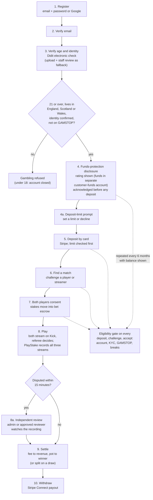
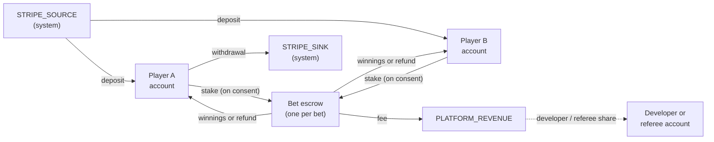

# Document 09 — End-to-End Customer and System Flow

| | |
|---|---|
| **Operator** | [COMPANY NAME], trading as PlayStake |
| **Owner** | [COMPLIANCE LEAD NAME], Head of Compliance (with engineering) |
| **Version** | 0.1 — draft for licence application |
| **Review** | On any change to registration, verification, payments, games or settlement; at least annually |
| **Relates to** | Remote operating licence application: end-to-end diagram including the location of remote gambling equipment; Documents 08 and 10 |

> Draft prepared from the platform as built on 30 September 2026. `[BRACKETS]` must be completed before submission.

## 1. Purpose

This document follows a customer from registration to gambling to getting their money out, showing at each step which system does the work, which checks apply, and where the equipment is. Remote gambling equipment in the sense of the Gambling Act 2005 — the servers that register customers, record stakes, decide results and hold the wallet — is the PlayStake web service, worker service and PostgreSQL database, all hosted by Railway in its **EU West region (`europe-west4`, Amsterdam, Netherlands)** (Document 10 §3).

## 2. The journey at a glance

## 3. Step by step

All PlayStake steps run on the web service or worker service with data in PostgreSQL, hosted by Railway, unless another location is given. Railway region: EU West (`europe-west4`, Amsterdam, Netherlands).

| Step | What happens | Controls | System and location |
|---|---|---|---|
| **1. Register** | Customer creates an account with email and password, or signs in with Google. Terms, privacy, 21+ and residence in England, Scotland or Wales confirmed; under-21 dates of birth refused. | Password strength rules; bcrypt hashing; rate limits on registration and sign-in; lockout after repeated failures | Web service (Railway). Google sign-in: Google. |
| **2. Verify email** | A link is emailed. Identity verification can't be started until the email is verified, so nobody can deposit or gamble with an unverified address. | Single-use, expiring token | Email sent through Resend from the worker's outbox |
| **3. Verify age and identity** | Customer completes Didit's hosted check: identity document, selfie with liveness, proof of address. Didit checks the document, matches the face, reads the date of birth and screens against sanctions, PEP and adverse-media lists. PlayStake re-reads the decision from Didit's API and runs its own checks (date of birth, same identity on another account). Borderline results go to staff. Customers who can't use Didit upload documents for staff review instead. | Under-18s declined; automatic approval only when every step passes and no identity case is open; fallback documents encrypted (AES-256-GCM) at rest; every staff view logged; decision and reason recorded. No deposit, free play or gambling before approval. | Didit (EU, Spain). Decisions and fallback documents: web service + PostgreSQL (Railway). |
| **3a. GAMSTOP** *(planned)* | The verified identity is checked against GAMSTOP on verification, on sign-in and when a cached result is over 24 hours old. | Registered customers can't gamble; a failed check refuses gambling rather than allowing it | GAMSTOP API (UK) |
| **4. Funds-protection disclosure** | Before any deposit the customer reads, in writing, PlayStake's customer-funds rating and what it means: "not protected – segregation of customer funds" once the separate customer-funds account is live (Policy 19 §2), "not protected – no segregation" until then, and ticks to acknowledge it. At least every six months a reminder showing the funds held for them must be acknowledged before they can stake. | LCCP 4.2.1. Deposits and stakes refused until the current wording is acknowledged; version and time recorded. Policy 19. | Web service (Railway) |
| **4a. Deposit-limit prompt** | Before the first deposit the customer must set a deposit limit or actively decline. Every six months they are reminded to review limits. | Limits are on gross deposits, per day/week/month; decreases apply at once, increases after 24 hours | Web service (Railway) |
| **5. Deposit** | Customer pays by card on a Stripe form. Stripe confirms payment by signed webhook; the ledger then moves funds from `STRIPE_SOURCE` to the player's account. | Eligibility gate; deposit limits (most restrictive applies); affordability and AML thresholds; webhook signature verified; idempotent ledger transfer | Card entry: Stripe. Webhook handling and ledger: Railway. |
| **6. Find a match** | Customer challenges another player, or a live streamer, to EA SPORTS FC 27 or Tekken 8 and picks a stake (£1 to £500). The fee and what a win or draw pays are shown before commitment. | Eligibility gate on issuing and accepting a challenge, for both players; Match Rules accepted before the first challenge; unanswered challenges expire | Web service; real-time challenge events through Redis (Railway) |
| **7. Consent and escrow** | Each player explicitly consents. Only then is their stake moved from their account into a per-bet escrow account. | Sufficient-funds check in the same database statement as the debit; no stake taken without consent; unanswered bets expire and refund | Ledger in PostgreSQL (Railway) |
| **8. Play** | Both players stream their own screen on Kick. An independent, approved referee watches both streams and records the result (a win for either player, or a draw) with written notes. | Players can't declare results; the referee can't officiate their own match or players they follow, are followed by or have a block with; every referee action is written to a hash-chained, append-only audit trail; no referee within 10 minutes, or not finished within 2 hours, cancels the match with stakes returned in full; a player who drops and doesn't return within 10 minutes may lose the match on the referee's decision | Referee console: web service (Railway). Stream video: Kick. |
| **8a. Recording** | From the moment the referee starts the match until the result, PlayStake's recorder captures both players' and the referee's streams, with sound and the match clock, into one video. Its SHA-256 fingerprint is sealed into the referee audit trail. | Recording page opened only with a signed token; stored privately; deleted after 30 days, or 12 months after a dispute is decided (Document 18) | Recorder service (Railway); storage: Cloudflare R2 (EU) |
| **8b. Dispute** | Either player can dispute within 15 minutes, pointing to moments in the match. An admin or an approved dispute reviewer decides it: never a player, the match referee, or anyone linked to a player by a follow or block. They take the dispute (so only one person decides), watch the recording and give written reasons. | Conflict checks; claims and decisions in the hash-chained audit trail and admin audit log; every viewing of a recording logged | Web service (Railway); recording from R2 |
| **9. Settle** | The fee goes to `PLATFORM_REVENUE`, any developer or referee share is paid, and the rest of the escrow goes to the winner (or is split on a draw). Escrow must end at exactly zero. | Stream matches settle only after the dispute window; mismatched results open a dispute; settlement worker takes a row lock; daily ledger audit checks every account and transaction balances | Worker service or web service (Railway) |
| **10. Withdraw** | Customer onboards to Stripe Connect Express once, then requests a withdrawal. The ledger debits their balance to `STRIPE_SINK` and Stripe pays out to their bank. | Verified identity required; suspended accounts can't withdraw; self-excluded and GAMSTOP-registered customers **can** withdraw; payout account name to be matched to the verified name | Ledger: Railway. Payout: Stripe. |

## 4. Money flow

Every arrow is one call to the ledger's `transfer()`, which writes one debit and one matching credit and can never leave an account (other than the three system accounts) below zero.

## 5. Where the equipment is

| Component | Provider | Location |
|---|---|---|
| Web service (website, API, referee console) | Railway | EU West, `europe-west4` (Amsterdam, Netherlands) |
| Worker service (settlement, expiry, detection, email, webhooks, recording retention) | Railway | EU West, `europe-west4` |
| Recorder service (records each refereed match) | Railway | EU West, `europe-west4` |
| PostgreSQL (all records, ledger, encrypted KYC documents) | Railway | EU West, `europe-west4` |
| Database backups | Railway | [BACKUP LOCATION — confirm in Railway] |
| Redis (queues, challenge events) | Railway | EU West, `europe-west4` |
| Match recordings | Cloudflare R2 | EU jurisdiction bucket |
| Identity checks | Didit | EU (Spain) |
| Card processing and payouts | Stripe | Stripe data centres (EU/US) |
| Email delivery | Resend | [RESEND REGION] |
| Error monitoring | Sentry | EU (Germany) |
| Live video | Kick | Kick |

No remote gambling equipment is located in Great Britain: all of it is in Railway's EU West region in the Netherlands. The Commission must be told where remote gambling equipment is and of any change (Document 14).

| Version | Date | Change |
|---|---|---|
| 0.1 | 30 September 2026 | First draft |
| 0.2 | 27 October 2026 | Didit identity checks; funds-protection disclosure; match recording and independent dispute review; Railway region recorded (EU West, Netherlands) |
